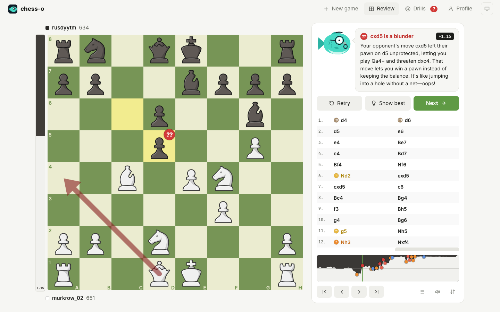
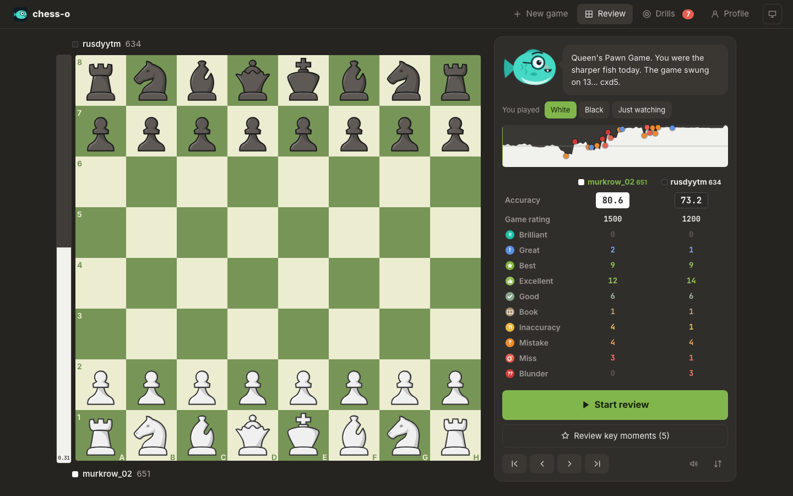
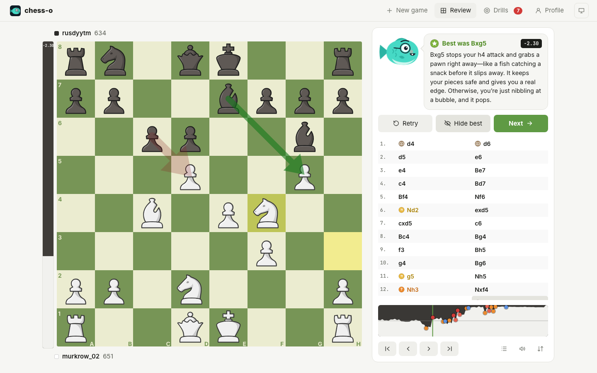
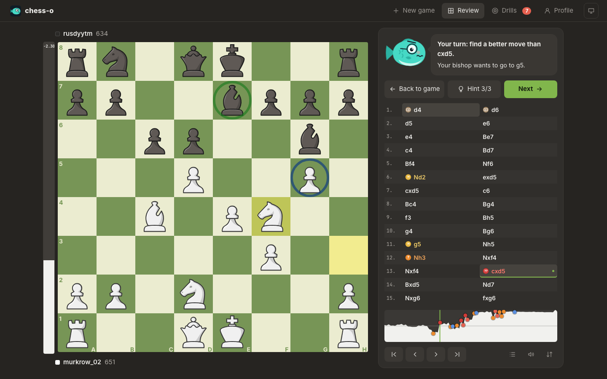
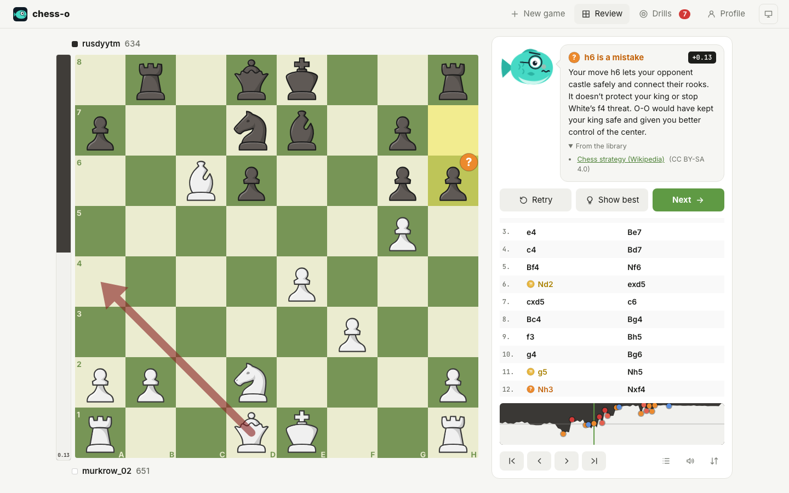
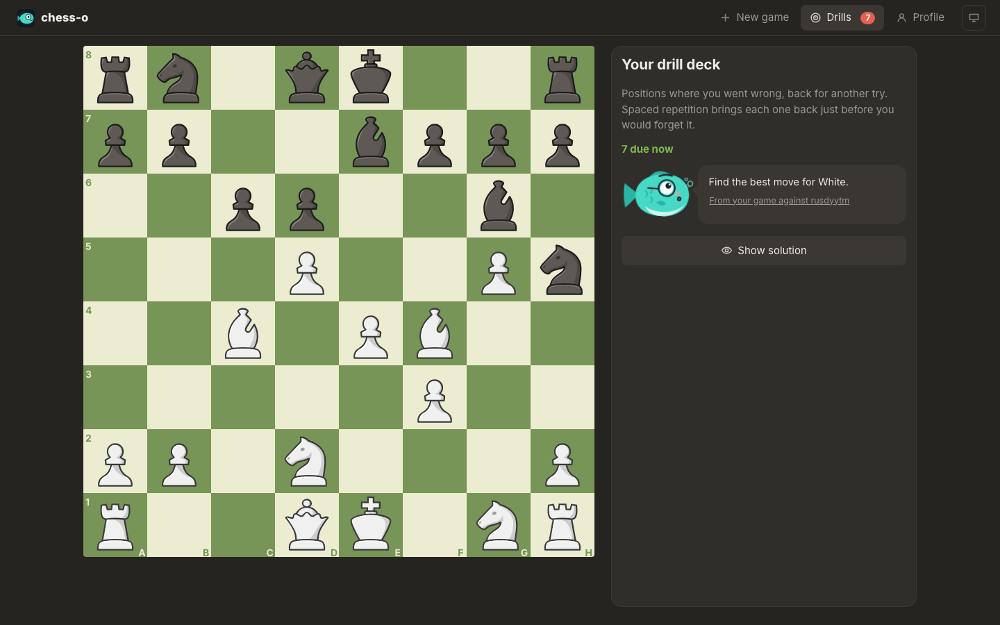
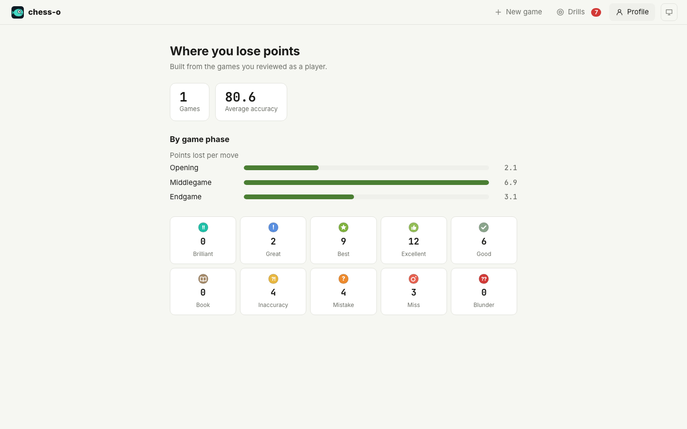

<p align="center">
  
</p>

<h1 align="center">chess-o</h1>

<p align="center">
  Self-hosted chess game review with a coach that actually knows what it is talking about.<br>
  Stockfish does the chess. A small local LLM, Giacomino the fish, only puts the engine's facts into words.
</p>

<p align="center">
  
</p>

## Why

Online game reviews are great until you want them on your own server, for free, without an
account, and without a chatbot inventing variations. chess-o keeps the two jobs apart:

- **The engine decides.** Every classification, threat and "better was…" comes from Stockfish
  and python-chess. The rules are written down in [docs/ANALYSIS.md](docs/ANALYSIS.md).
- **The model explains.** Giacomino gets a facts object per move and may only name moves the
  engine supplied. Anything else is caught and rewritten before you see it.
- **Everything runs at home.** Stockfish runs in the backend container; the LLM and the embeddings
  run on any Ollama (or other OpenAI-compatible) server you point it at.

## Features

**Review**
- Board with eval bar, last move, a classification badge on the destination square, the
  opponent's punishing reply for bad moves and the best move on demand.
- Ten move classes: Brilliant, Great, Best, Excellent, Good, Book, Inaccuracy, Mistake, Miss, Blunder.
- Clickable eval graph with markers for the big moments, move list with icons, keyboard
  navigation (← → to step, ↑ ↓ or Home End to jump, F to flip), move sounds synthesized in the browser.
- Summary with accuracy per side, counts per class, a rough game rating and the opening name.

**Learning**
- **Retry**: replay a bad move yourself, with three levels of hints (which piece, where to,
  what it threatens).
- **Explore**: play any move on the board and Giacomino comments on it with a fresh engine check.
- **Key moments**: jump straight to the five plies that decided the game, analysed deeper.
- **Drills**: your own mistakes come back as puzzles on a spaced-repetition schedule.
- **Profile**: where you lose points, by game phase and move class.

**Coach**
- Streams token by token, prefetches the next moves, caches everything.
- Ask follow-up questions under any explanation. Moves you name ("what about Nf4?") are
  checked by the engine before Giacomino answers.
- Draws on a local knowledge base built only from freely licensed texts (Wikipedia, Wikibooks'
  opening theory, public-domain classics by Capablanca and Lasker), plus any PDF or Markdown you
  add yourself. Sources are linked under each explanation.

**Input**
- Paste or drop a PGN, or import recent games by username from Lichess or Chess.com.
- Link your Chess.com account: new games sync on their own with your side already set, and
  "Review latest Chess.com game" fetches and opens the game you just finished. Chess.com only
  offers OAuth to approved partners, so linking reads your public games by username; no password.

**Everywhere**
- English and Italian, switchable in the top bar; Giacomino answers in the same language.
- Works on phones and installs as an app (PWA). Installing needs HTTPS; the container
  serves it out of the box, see [HTTPS on a private network](#https-on-a-private-network).
- "Delete all data" on the Profile page wipes games, reviews, drills and the linked account.

<table>
  <tr>
    <td></td>
    <td></td>
  </tr>
  <tr>
    <td></td>
    <td></td>
  </tr>
  <tr>
    <td></td>
    <td></td>
  </tr>
</table>

Light and dark themes follow your system, with a switch in the top bar.

## Quick start

You need Docker and an Ollama server (it can be the same machine).

```bash
# on the Ollama machine
ollama pull gemma4:e4b
ollama pull bge-m3

# here
git clone https://github.com/Murkrow02/chess-o.git
cd chess-o
cp .env.example .env        # set LLM_BASE_URL and EMBED_BASE_URL to your Ollama
docker compose up -d --build
```

Open `http://<host>:8080`. On the first start the backend builds the knowledge base in the
background (downloads about 7 MB of text and embeds it, roughly ten minutes on a small GPU).
Reviews work straight away; explanations get their background passages once it is done.
`GET /api/knowledge` shows the progress.

Without a reachable LLM, the review still works and the coach falls back to fixed templates.

## Configuration

All settings live in `.env` (git-ignored). The main ones:

| Variable | Default | What it does |
|---|---|---|
| `LLM_BASE_URL` | | OpenAI-compatible endpoint, e.g. `http://ollama:11434/v1` |
| `LLM_MODEL` | `gemma4:e4b` | Coach model |
| `LLM_API_KEY` | empty | For endpoints that need one |
| `LLM_REASONING_EFFORT` | `none` | Turns off "thinking" on hybrid models such as Gemma 4 and Qwen3; leave empty if your server rejects it |
| `EMBED_BASE_URL`, `EMBED_MODEL` | `bge-m3` | Ollama used for the knowledge base |
| `RAG_AUTO_INGEST` | `true` | Build the knowledge base on first start |
| `ENGINE_WORKERS` | `0` | Stockfish processes; 0 means CPU cores minus one |
| `ENGINE_DEPTH`, `ENGINE_DEEP_DEPTH` | `14`, `20` | Full-game pass and key-moment pass |
| `ENGINE_MULTIPV` | `3` | Candidate lines per position |
| `CHESSO_PORT` | `8080` | Port of the web UI (HTTP) |
| `CHESSO_HTTPS_PORT` | `8443` | Port of the web UI (HTTPS) |
| `TLS_HOSTS` | `localhost,127.0.0.1` | Names and IPs in the HTTPS certificate |

**Picking a model.** A small instruct model is the sweet spot on modest hardware. On an AMD 680M
iGPU we compared Gemma 4 E4B, Qwen3 4B Instruct, Qwen3.5 4B and a 270M chess-commentary
fine-tune on the same game facts, in English and Italian. Gemma 4 E4B starts answering in about
two seconds, finishes an explanation in about four, and sticks closest to the facts; Qwen3 4B is
smaller (2.5 GB against 6.6 GB) but invents more about the position, Qwen3.5 was much slower to
start, and the 270M model misjudged moves. 8B models were five times slower there. Whatever you
pick, a context of 4096 tokens is enough; with Ollama you can bake it in:

```bash
printf 'FROM gemma4:e4b\nPARAMETER num_ctx 4096\n' > Modelfile
ollama create chesso-coach -f Modelfile   # then LLM_MODEL=chesso-coach
```

If the coach and the embeddings share one Ollama, set `OLLAMA_MAX_LOADED_MODELS=2` there so
the two models do not keep evicting each other.

## HTTPS on a private network

Browsers only install a PWA over HTTPS. The frontend container serves HTTPS on
`CHESSO_HTTPS_PORT` (default 8443) with a certificate signed by its own small certificate
authority, created on first start and kept in the `chesso-certs` volume.

1. Put the address you open the app at in `.env`, e.g. `TLS_HOSTS=192.168.1.20,chess.lan`, and
   run `docker compose up -d`. The certificate is re-issued whenever `TLS_HOSTS` changes.
2. Download the authority from `http://<host>:8080/ca.crt` and trust it once per device:
   - **iPhone/iPad**: open the file, install the profile in Settings, then enable it under
     Settings > General > About > Certificate Trust Settings.
   - **Android**: Settings > Security > Encryption & credentials > Install a certificate > CA certificate.
   - **macOS**: open it in Keychain Access and set it to "Always Trust". **Windows**: install it
     into "Trusted Root Certification Authorities".
3. Open `https://<host>:8443` and install the app from the browser menu.

A plain self-signed certificate with a click-through warning is not enough: browsers refuse
to register the service worker on an untrusted certificate. To use your own certificate
instead, put `cert.pem` and `key.pem` in the `chesso-certs` volume and delete `.generated`.
The authority's private key never leaves that volume; keep it to yourself.

## Your own books and notes

Drop PDF, Markdown or text files in [`knowledge/custom/`](knowledge/custom/) and re-index:

```bash
docker compose exec backend python -m scripts.ingest --only custom
# or: curl -X POST http://<host>:8080/api/knowledge/ingest
```

Only add material you have the right to use. Downloads and embeddings are cached, so a re-run
only embeds what changed.

## How it works

```
PGN ─► FastAPI ─► Stockfish pool (depth 14, MultiPV 3, threat probes) ─► classification + facts
                      └─► deep pass on key moments (depth 20)
facts ─► retrieval (opening page by position, concepts by meaning) ─► prompt ─► LLM (streamed)
                                                                      └─► move check ─► you
```

- **Backend**: Python 3.12, FastAPI, python-chess, Stockfish 19, SQLite with sqlite-vec for
  games, the engine cache, drills and the knowledge base. No extra database container.
- **Frontend**: React, Vite, TypeScript, chessground and chessops, Zustand. All UI text is in
  [`frontend/src/locales/`](frontend/src/locales/) and the coach's wording in
  [`backend/app/locales/`](backend/app/locales/), so a new language is two files; it appears in
  the picker on its own.
- **Serving**: nginx serves the app and proxies `/api` with buffering off for the
  Server-Sent Events. The frontend only uses relative URLs.

Details: [docs/ANALYSIS.md](docs/ANALYSIS.md) (classification, accuracy, facts) and
[docs/PLAN.md](docs/PLAN.md) (architecture).

## Development

```bash
# backend
python -m venv .venv && .venv/bin/pip install -r backend/requirements.txt -r backend/requirements-dev.txt
cd backend && ../.venv/bin/uvicorn app.main:app --reload --port 8765
../.venv/bin/python -m pytest tests

# frontend (proxies /api to :8765, or to API_URL)
cd frontend && npm install && npm run dev
```

A `stockfish` binary must be on the `PATH` (or set `STOCKFISH_PATH`).

## Licences and credits

chess-o is free software under the [GNU GPL v3](LICENSE).

- [chessground](https://github.com/lichess-org/chessground) and
  [chessops](https://github.com/niklasf/chessops) by the lichess team, GPL-3.0.
- [Stockfish](https://stockfishchess.org/), GPL-3.0, and [python-chess](https://github.com/niklasf/python-chess), GPL-3.0.
- **Pieces**: "Staunty" by sadsnake1, from lichess,
  [CC BY-NC-SA 4.0](https://creativecommons.org/licenses/by-nc-sa/4.0/). They are not covered by
  the GPL and allow non-commercial use only; swap the files in `frontend/public/pieces/` if you need otherwise.
- **Opening names**: [lichess chess-openings](https://github.com/lichess-org/chess-openings), CC0.
- **Knowledge base**: Wikipedia and Wikibooks texts under CC BY-SA 4.0 by their contributors;
  Project Gutenberg books in the public domain. The texts are downloaded at install time, not
  shipped in this repository, and every passage the coach uses is linked to its source.
- Giacomino, the icons, the board theme and the sounds are original to this project.
